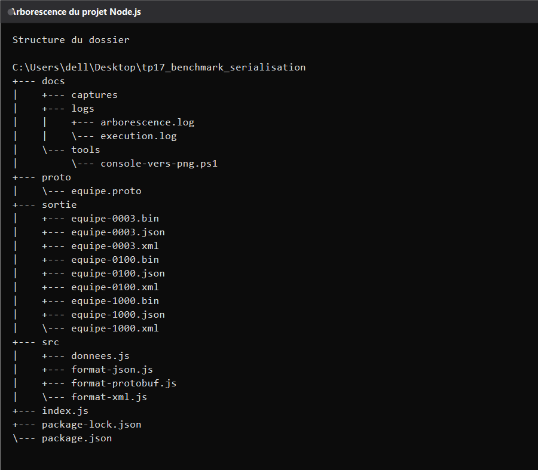
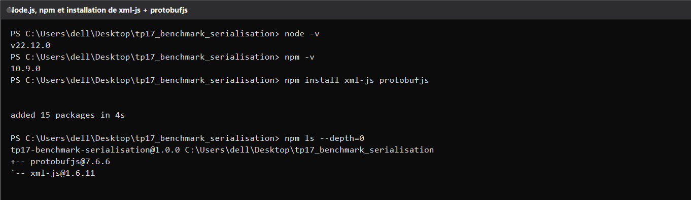
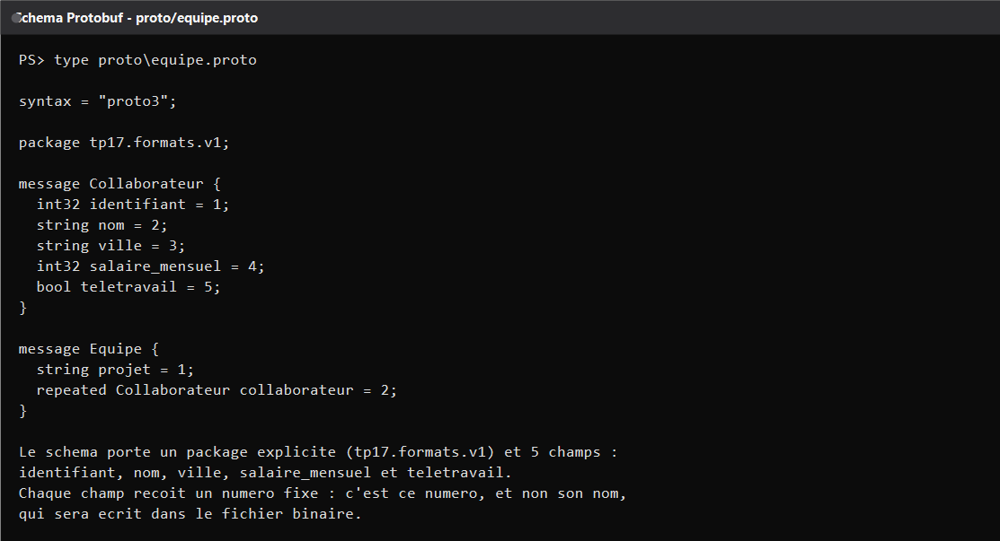
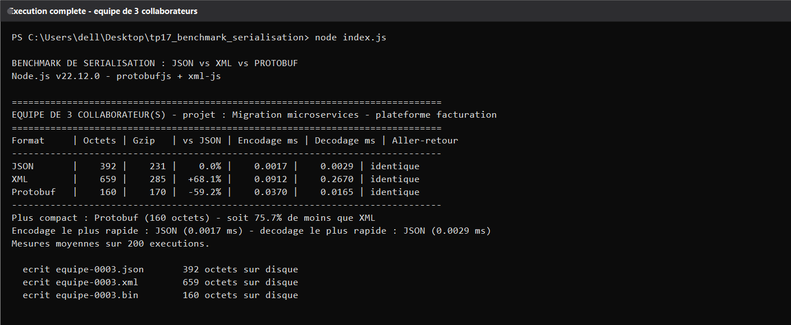
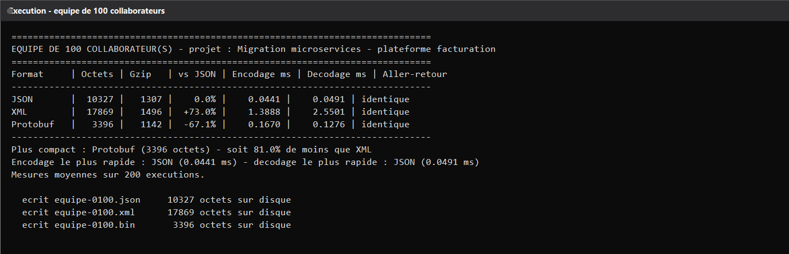
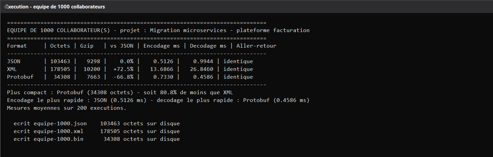
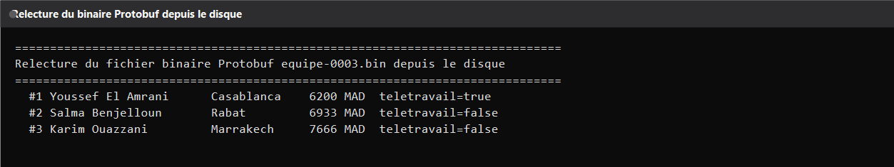
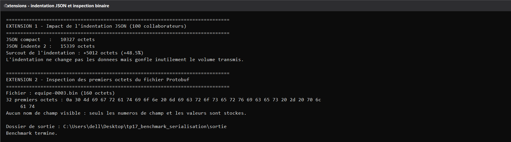
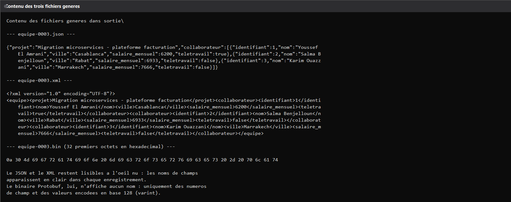
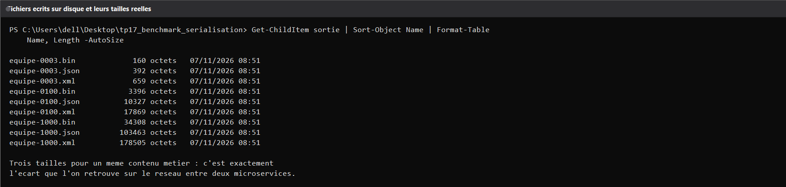

# TP 17 - Comparer JSON, XML et Protobuf avec Node.js

Ce projet compare trois facons de serialiser les memes donnees avec Node.js : le texte JSON, le texte XML et le binaire Protocol Buffers. Un meme jeu de collaborateurs est encode dans les trois formats, ecrit sur disque, puis mesure en taille, en compression et en temps d'encodage comme de decodage.

Le jeu de donnees est personnalise : douze noms, huit villes marocaines, un salaire mensuel et un indicateur de teletravail. Le projet est une migration de plateforme de facturation, ce qui change des exemples generiques du cours.

## Structure du projet

Le code est decoupe en modules : un fichier de donnees, un module par format et un script principal qui orchestre les mesures.

Le dossier proto contient le contrat de donnees, le dossier src les encodeurs et decodeurs, le dossier sortie les fichiers generes. Le dossier docs ne sert qu'aux captures et aux journaux d'execution.

## Creation du projet et dependances

Le projet est initialise avec npm, puis deux bibliotheques sont installees : xml-js pour la conversion entre objets JavaScript et XML, et protobufjs pour charger un schema et encoder en binaire sans compilateur externe.

Les versions retenues sont protobufjs 7.6.6 et xml-js 1.6.11, sur Node.js v22.12.0.

## Le schema Protobuf

Le fichier equipe.proto declare deux messages. Le message Collaborateur porte cinq champs numerotes, et le message Equipe regroupe un nom de projet avec une liste repetee de collaborateurs dans un package explicite.

Les numeros de champ sont la piece maitresse du format : c'est eux, et non les noms, qui partiront dans le fichier binaire. Renommer un champ ne casse donc rien, alors que changer son numero rend les anciens messages illisibles.

## Premier essai : trois collaborateurs

Le script construit une equipe de trois personnes, encode dans les trois formats, puis affiche la taille, la taille compressee en gzip, l'ecart par rapport au JSON, le temps moyen d'encodage, le temps moyen de decodage et une verification d'aller-retour.

Des trois, le JSON est le plus rapide a encoder et a decoder, mais le Protobuf est deja le plus compact. Le XML arrive dernier sur les deux tableaux : il est a la fois le plus volumineux et le plus lent.

## Montee en charge : cent puis mille collaborateurs

La meme equipe est ensuite generee avec cent collaborateurs, puis avec mille, pour voir comment les ecarts evoluent.

Le rapport de taille reste stable aux alentours de soixante-dix pour cent d'economie face au JSON. En revanche l'ecart de vitesse se creuse nettement : a mille collaborateurs, le XML demande plus de vingt-cinq millisecondes pour decoder ce que le Protobuf traite en une demi-milliseconde.

## Verification de l'aller-retour

Chaque format est relu immediatement apres son encodage et compare a l'objet d'origine, sans tenir compte de l'ordre des cles. La colonne Aller-retour doit afficher identique partout.

Le fichier binaire de trois collaborateurs est ensuite relu depuis le disque et redonne exactement les memes noms, villes, salaires et indicateurs de teletravail. C'est la preuve que la compacite n'a rien coute en fidelite.

## Pour aller plus loin

Deux extensions ont ete ajoutees au script. La premiere mesure le cout de l'indentation du JSON, la seconde inspecte les octets bruts du fichier Protobuf.

Indenter le JSON ajoute presque cinquante pour cent de volume pour zero information supplementaire, ce qui illustre l'erreur classique en production. De son cote, le binaire ne laisse apparaitre aucun nom de champ dans ses premiers octets, uniquement des numeros et des valeurs encodees en varint.

## Les fichiers produits

Le script ecrit neuf fichiers dans le dossier sortie, soit trois tailles d'equipe multipliees par trois formats.

Le JSON et le XML restent lisibles a l'oeil nu, ce qui aide au debogage. Le binaire Protobuf, lui, exige le schema pour etre relu, ce qui est le prix de sa compacite.

Les tailles affichees par le script correspondent exactement a celles des fichiers sur le disque. Un meme contenu metier occupe donc trois volumes tres differents selon le format choisi.

## Conclusion

Protobuf n'est pas seulement plus petit, il devient aussi plus rapide que le XML des que le volume augmente. JSON garde l'avantage de la simplicite et de la lisibilite, ce qui explique qu'il reste le choix par defaut des API REST. Pour de la communication entre microservices a forte volumetrie, comme dans un contexte gRPC, le binaire Protobuf s'impose naturellement.

## Lancer le projet

Il faut Node.js, puis installer les dependances et demarrer le script. Le resultat s'affiche directement dans le terminal et les fichiers apparaissent dans le dossier sortie.
